<div align="center">

# hesse

**Live Loss-Landscape Curvature Tracking & Edge-of-Stability Diagnostics in PyTorch**

[](https://www.python.org/downloads/)
[](https://pytorch.org/)
[](https://opensource.org/licenses/MIT)
[](https://github.com/astral-sh/ruff)
<!-- CI: placeholder for GitHub Actions build badge (Phase 8) -->

<p align="center">
  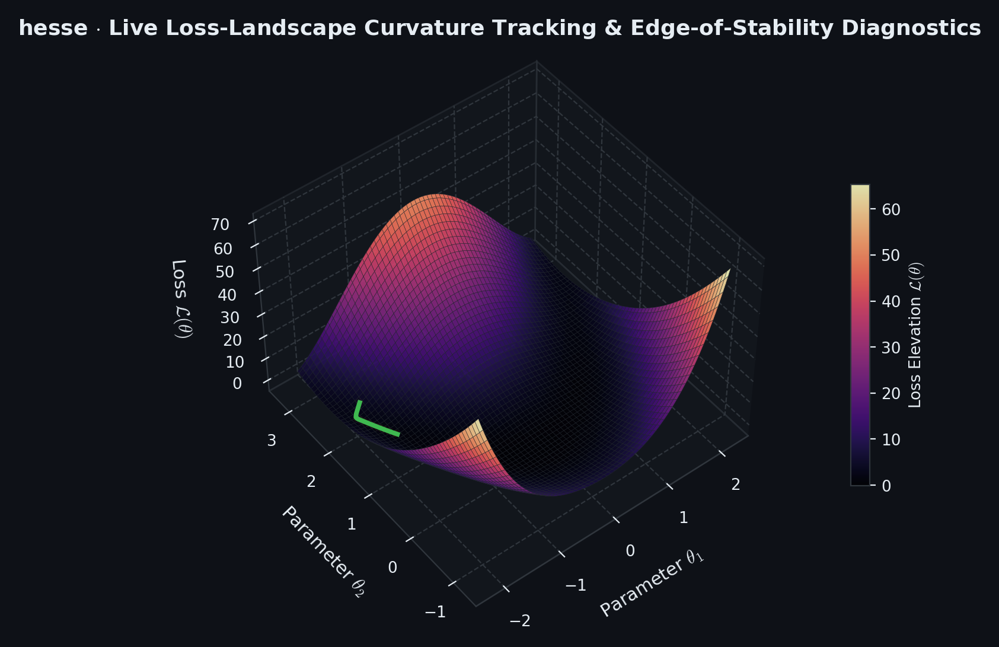
</p>
<p align="center"><em>Live loss-landscape curvature tracking and optimization trajectory over a non-convex anisotropic valley.</em></p>

</div>

---

### Contents

- [The Problem](#the-problem)
- [Key Mathematical Ideas](#key-mathematical-ideas)
- [Architecture](#architecture)
- [Planned Experiments](#planned-experiments)
- [Repository Structure](#repository-structure)
- [Quickstart](#quickstart)
- [Results](#results)
- [Roadmap](#roadmap)
- [Limitations and Future Work](#limitations-and-future-work)
- [References](#references)

---

## The Problem

Understanding the geometry of neural network loss landscapes is central to resolving fundamental open problems in deep learning optimization, generalization, and stability. While first-order gradients govern the instantaneous direction of parameter updates, second-order curvature—captured by the Hessian matrix of the loss with respect to network parameters—dictates the local landscape topology:

1. **Generalization and Basin Sharpness:** The geometry of converged local minima strongly influences generalization on unseen data. Classical and modern statistical learning theory indicates that wide, flat minima (characterized by small Hessian eigenvalues and small trace) exhibit lower Rademacher complexity and higher robustness to distribution shifts, whereas sharp, narrow ravines (large top eigenvalue $\lambda_{\max}$) often suffer from poor out-of-distribution generalization.
2. **Dynamical Optimization Stability:** In classical convex optimization, gradient descent is stable only when the learning rate $\eta$ satisfies the classical bound $\eta < 2/L$, where $L = \lambda_{\max}$ is the Lipschitz constant of the gradient. In non-convex deep learning, training does not remain confined to a static low-curvature basin; rather, the curvature evolves nonlinearly throughout training.
3. **Principled Learning-Rate Selection:** Learning rates are overwhelmingly chosen via empirical grid search or heuristic learning rate schedules. Without tracking curvature dynamically, practitioners cannot determine whether an optimizer is operating in a classical monotonic descent regime, a turbulent self-stabilizing boundary, or a chaotic divergence regime.

Existing second-order diagnostic tools, such as [PyHessian](https://github.com/amirgholami/PyHessian) (Yao et al., 2020), operate almost exclusively as *post-hoc* analyzers evaluated at isolated checkpoints after training has terminated. While valuable for static inspections, single-checkpoint analysis fails to capture the continuous dynamical evolution of curvature:
- **Missing Progressive Sharpening:** Early in training, neural networks consistently undergo *progressive sharpening*, where $\lambda_{\max}$ monotonically climbs by orders of magnitude. Static checkpoints cannot reveal when or why this sharpening begins.
- **Missing the Edge of Stability (EoS):** Gradient descent routinely enters a non-monotonic regime where sharpness hovers near the critical threshold $2/\eta$. In this regime, loss oscillates wildly at the individual iteration scale while continuing to decrease across macro-epochs. Static post-training evaluations miss the oscillatory dynamics and self-stabilization mechanics that govern this state.
- **Missing Optimizer Discrepancies:** Adaptive optimizers such as Adam and sign-based optimizers such as Lion alter the effective curvature via non-uniform preconditioners. Static Hessian metrics evaluated without preconditioning yield misleading conclusions about stability.

`hesse` bridges this gap. Named in honor of the mathematician Otto Hesse, `hesse` is an open-source PyTorch toolkit designed for **continuous, live tracking of Hessian spectral properties throughout training**, featuring zero-materialization Hessian-vector products, automated stability boundary diagnostics, and real-time loss-landscape slicing.

---

## Key Mathematical Ideas

### 1. The Hessian Matrix and Local Sharpness

Let $\mathcal{L}(\theta) = \frac{1}{N} \sum_{i=1}^N \ell(f(x_i; \theta), y_i)$ denote the empirical loss over parameters $\theta \in \mathbb{R}^P$. The Hessian $H(\theta) \in \mathbb{R}^{P \times P}$ is the symmetric second-order partial derivative matrix:

$$H(\theta) \equiv \nabla_\theta^2 \mathcal{L}(\theta) = \begin{bmatrix} \frac{\partial^2 \mathcal{L}}{\partial \theta_1^2} & \frac{\partial^2 \mathcal{L}}{\partial \theta_1 \partial \theta_2} & \cdots & \frac{\partial^2 \mathcal{L}}{\partial \theta_1 \partial \theta_P} \\ \frac{\partial^2 \mathcal{L}}{\partial \theta_2 \partial \theta_1} & \frac{\partial^2 \mathcal{L}}{\partial \theta_2^2} & \cdots & \frac{\partial^2 \mathcal{L}}{\partial \theta_2 \partial \theta_P} \\ \vdots & \vdots & \ddots & \vdots \\ \frac{\partial^2 \mathcal{L}}{\partial \theta_P \partial \theta_1} & \frac{\partial^2 \mathcal{L}}{\partial \theta_P \partial \theta_2} & \cdots & \frac{\partial^2 \mathcal{L}}{\partial \theta_P^2} \end{bmatrix}$$

Because $H(\theta)$ is real and symmetric (by Schwarz's theorem on mixed partials), it admits an orthogonal eigendecomposition:

$$H(\theta) = Q \Lambda Q^T = \sum_{j=1}^P \lambda_j q_j q_j^T, \quad \lambda_1 \ge \lambda_2 \ge \dots \ge \lambda_P$$

where $q_j \in \mathbb{R}^P$ are orthonormal eigenvectors and $\lambda_j \in \mathbb{R}$ are the associated eigenvalues. The **sharpness** of the loss surface at $\theta$ is defined as the maximum eigenvalue:

$$\lambda_{\max} \equiv \lambda_1 = \sup_{v \neq 0} \frac{v^T H(\theta) v}{v^T v}$$

The scalar $\lambda_{\max}$ quantifies the maximum directional curvature: along the eigenvector $q_1$, a displacement $\delta$ produces the largest second-order change in loss, $\Delta \mathcal{L} \approx \frac{1}{2} \lambda_{\max} \|\delta\|_2^2$.

<p align="center">
  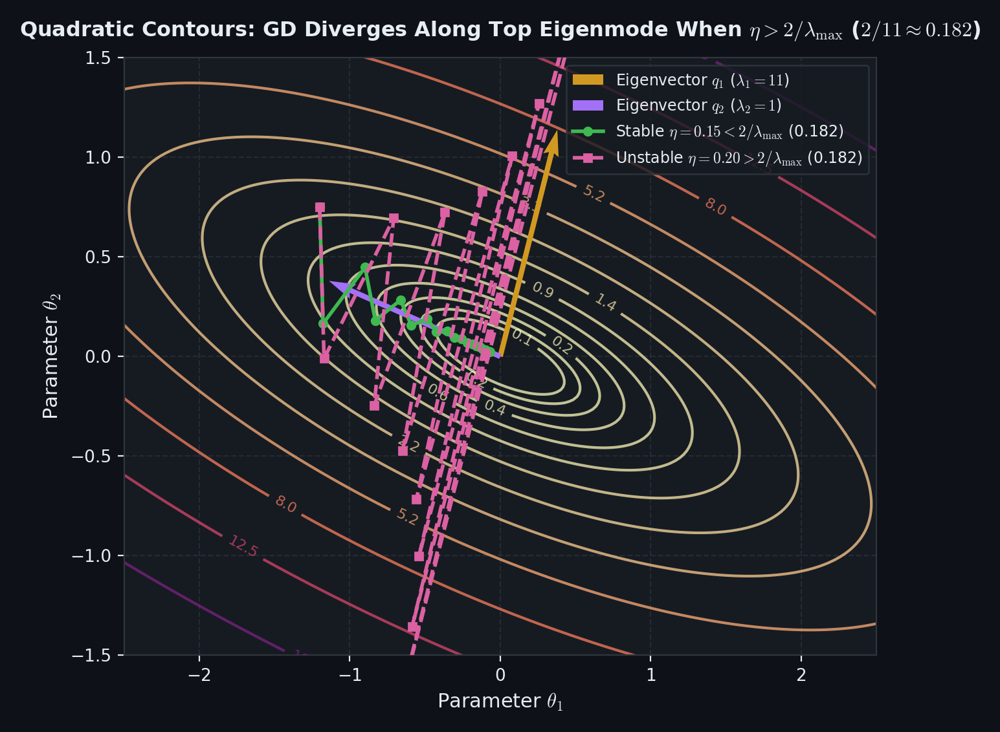
</p>
<p align="center"><em>2D quadratic loss contours ($H = [[2,3],[3,10]]$): Gradient descent is stable along the top eigenmode for $\eta = 0.15 < 2/\lambda_{\max}$, but diverges exponentially for $\eta = 0.19 > 2/\lambda_{\max}$ ($2/11 \approx 0.182$).</em></p>

### 2. Derivation of the $2/\eta$ Linear Stability Threshold

To understand why $2/\eta$ forms a fundamental dynamical boundary, consider the one-dimensional scalar quadratic objective:

$$\mathcal{L}(x) = \frac{1}{2} \lambda x^2, \quad \lambda > 0$$

The first and second derivatives are:

$$\nabla \mathcal{L}(x) = \lambda x, \quad \nabla^2 \mathcal{L}(x) = \lambda$$

Gradient descent with a constant step size (learning rate) $\eta > 0$ generates the iterate sequence:

$$x_{t+1} = x_t - \eta \nabla \mathcal{L}(x_t) = x_t - \eta \lambda x_t = (1 - \eta \lambda) x_t$$

By recursive induction, the iterate at step $t$ is expressed in terms of the initial parameter $x_0$:

$$x_t = (1 - \eta \lambda)^t x_0$$

For the optimization process to converge to the global minimizer $x^* = 0$ from an arbitrary initialization $x_0 \neq 0$, the convergence criterion requires:

$$\lim_{t \to \infty} x_t = 0 \iff |1 - \eta \lambda| < 1$$

Expanding the absolute value into compound linear inequalities:

$$-1 < 1 - \eta \lambda < 1$$

Subtracting $1$ from all terms:

$$-2 < -\eta \lambda < 0$$

Multiplying by $-1$ and reversing the inequality directions:

$$0 < \eta \lambda < 2$$

Since both $\eta > 0$ and $\lambda > 0$, dividing by $\eta$ yields the exact stability condition:

$$\lambda < \frac{2}{\eta}$$

<p align="center">
  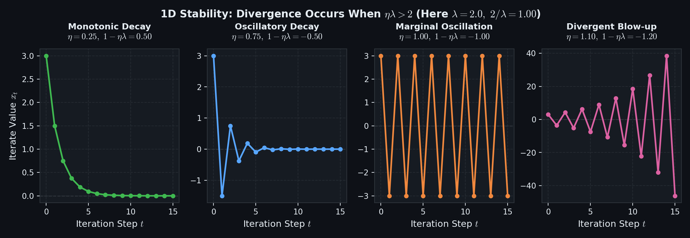
  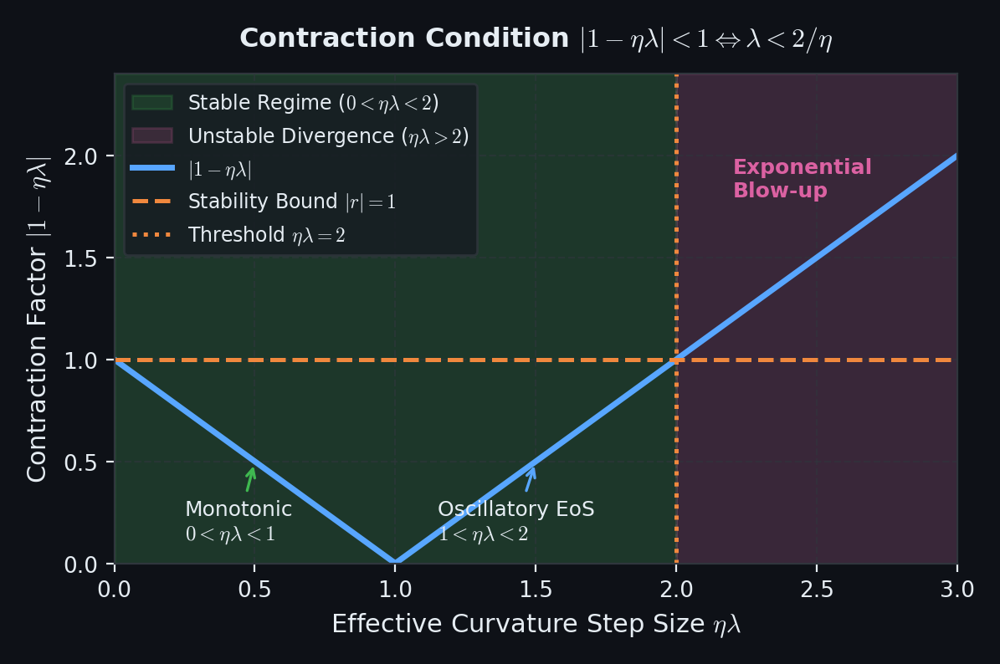
</p>
<p align="center"><em>Left: 1D iterate dynamics $x_t$ across monotonic, oscillatory, and divergent regimes ($2/\lambda = 1.0$). Right: Absolute contraction factor $|1 - \eta\lambda|$ with stable and unstable regions.</em></p>

#### Generalization to Multi-Dimensional Quadratics

For a multidimensional quadratic $\mathcal{L}(\theta) = \frac{1}{2} (\theta - \theta^*)^T H (\theta - \theta^*)$, gradient descent obeys:

$$\theta_{t+1} - \theta^* = (I - \eta H)(\theta_t - \theta^*) = Q (I - \eta \Lambda) Q^T (\theta_t - \theta^*)$$

Decoupling the dynamics into the orthogonal eigenbasis $u_t = Q^T (\theta_t - \theta^*)$:

$$[u_{t+1}]_j = (1 - \eta \lambda_j) [u_t]_j \implies [u_t]_j = (1 - \eta \lambda_j)^t [u_0]_j \quad \forall j \in \{1, \dots, P\}$$

Simultaneous convergence along all coordinate modes requires:

$$\max_{1 \le j \le P} |1 - \eta \lambda_j| < 1 \iff \lambda_{\max} < \frac{2}{\eta}$$

If $\lambda_{\max} > 2/\eta$, the dominant mode diverges exponentially with alternating sign: $(1 - \eta \lambda_{\max}) < -1$.

### 3. Progressive Sharpening and the Edge of Stability

Classical optimization theory treats the objective landscape as static, asserting that gradient descent operates strictly within the stable regime $\lambda_{\max} < 2/\eta$ to guarantee monotonic descent $\mathcal{L}(\theta_{t+1}) \le \mathcal{L}(\theta_t)$.

In deep neural networks, however, Cohen et al. (2021) demonstrated that this classical picture breaks down completely through two ubiquitous phenomena:

```
Loss Sharpness λ_max
       ▲
       │                                     Edge of Stability (EoS)
       │                              ┌─▲───▼───▲───▼───▲───▼─  hovering near 2/η
 2/η ──┼──────────────────────────────┴─────────────────────────  Stability Boundary
       │                            ／
       │                          ／
       │     Progressive        ／
       │     Sharpening       ／
       │                    ／
       │                  ／
       └─────────────────┴───────────────────────────────────────►
       0               t_cross                                Training Step t
```

1. **Progressive Sharpening:** During early training iterations, gradient descent drives $\theta$ along trajectories where the curvature $\lambda_{\max}(H(\theta_t))$ monotonically increases, irrespective of initialization or depth.
2. **The Edge of Stability (EoS):** Eventually, $\lambda_{\max}$ reaches the critical threshold $2/\eta$ at step $t_{\text{cross}}$. Rather than diverging catastrophically to infinity (as linear theory dictates for quadratics), nonlinear neural network dynamics self-regulate:
   - $\lambda_{\max}$ plateaus and hovers in a bounded band at or slightly above $2/\eta$.
   - At the iteration-by-iteration micro-scale, the training loss non-monotonically oscillates and spikes because updates overshoot along the top eigenvector $q_1$.
   - At the macro-epoch scale, the training loss continues to decay steadily toward zero.
3. **Self-Stabilization Mechanism:** Damian, Nichani, & Lee (2023) formalized the implicit bias of EoS: cubic and higher-order Taylor terms in the nonlinear landscape act as restoring forces. When an overshoot occurs, the asymmetric cubic curvature deflects the trajectory into neighboring flatter regions, suppressing unbounded growth and selecting flatter, better-generalizing minima.

### 4. Preconditioned Sharpness for Adaptive Optimizers (Adam)

Adaptive gradient methods introduce coordinate-wise non-uniform scaling that alters the effective curvature experienced by the parameter trajectory. Consider the standard update rule for Adam:

$$m_t = \beta_1 m_{t-1} + (1 - \beta_1) g_t, \quad v_t = \beta_2 v_{t-1} + (1 - \beta_2) g_t^2$$

$$\hat{m}_t = \frac{m_t}{1 - \beta_1^t}, \quad \hat{v}_t = \frac{v_t}{1 - \beta_2^t}$$

$$\theta_{t+1} = \theta_t - \eta \frac{\hat{m}_t}{\sqrt{\hat{v}_t} + \varepsilon}$$

Defining the diagonal preconditioning matrix $P_t \in \mathbb{R}^{P \times P}$:

$$P_t \equiv \operatorname{diag}\left(\sqrt{\hat{v}_t} + \varepsilon\right)$$

Adam performs preconditioned gradient descent accelerated by heavy-ball momentum:

$$\theta_{t+1} \approx \theta_t - \eta P_t^{-1} \hat{m}_t$$

To determine linear stability in the preconditioned space, perform the coordinate transformation $\tilde{\theta} = P_t^{1/2} \theta$. The effective second-order operator governing local dynamics is the **preconditioned Hessian**:

$$H_{\text{precond}} \equiv P_t^{-1/2} H(\theta) P_t^{-1/2} \quad \text{or equivalently the generalized eigenvalue problem } H v = \lambda P_t v$$

The metric governing stability under Adam is the **preconditioned sharpness**:

$$\lambda_{\max}(P_t^{-1} H)$$

Cohen et al. (2022) conducted linear stability analysis on this coupled recurrence under momentum factor $\beta_1 \in [0, 1)$. Expanding the second-order recurrence on a 1D quadratic mode yields the characteristic polynomial for the transition matrix:

$$\det \begin{bmatrix} (1 + \beta_1) - \eta_{\text{eff}} \lambda - \mu & -\beta_1 \\ 1 & -\mu \end{bmatrix} = 0 \iff \mu^2 - \left(1 + \beta_1 - \frac{1 - \beta_1}{1 - \beta_1^t} \eta \lambda_{\text{prec}}\right) \mu + \beta_1 = 0$$

At steady state ($t \to \infty$), the roots $\mu_1, \mu_2$ remain strictly within the complex unit disk $|\mu| < 1$ if and only if the preconditioned sharpness satisfies the stability boundary:

$$\lambda_{\max}(P_t^{-1} H) < \frac{2 + 2\beta_1}{(1 - \beta_1)\eta}$$

For standard Adam hyperparameters with $\beta_1 = 0.9$:

$$\frac{2 + 2(0.9)}{(1 - 0.9)\eta} = \frac{2 + 1.8}{0.1\eta} = \frac{3.8}{0.1\eta} = \frac{38}{\eta}$$

The theoretical stability threshold for Adam ($38/\eta$) is **19 times higher** than that of standard gradient descent ($2/\eta$). `hesse` explicitly tracks $\lambda_{\max}(P_t^{-1} H)$ to test whether adaptive optimizers exhibit an equivalent Edge-of-Stability phenomenon around $38/\eta$.

<p align="center">
  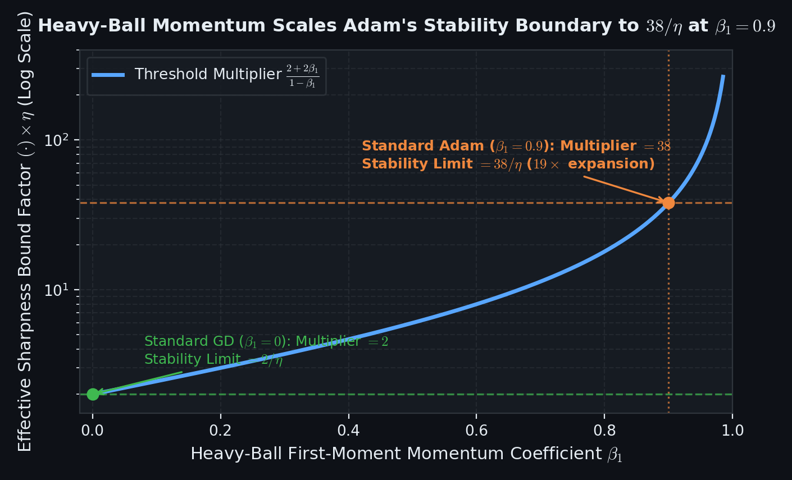
</p>
<p align="center"><em>Adam stability threshold multiplier $(2 + 2\beta_1)/(1 - \beta_1)$ as a function of momentum $\beta_1$, expanding from $2/\eta$ at $\beta_1=0$ to $38/\eta$ at standard $\beta_1=0.9$ ($19\times$ expansion).</em></p>

### 5. Pearlmutter's Hessian-Vector Product (HVP)

Explicitly materializing the full Hessian matrix $H \in \mathbb{R}^{P \times P}$ for a network with $P = 10^7$ parameters requires:

$$\frac{(10^7)^2 \times 4 \text{ bytes}}{10^{12}} \approx 400 \text{ Terabytes of RAM}$$

This is computationally intractable. However, spectral algorithms do not require individual matrix entries $H_{ij}$; they require only the directional action of the Hessian on an arbitrary vector $v \in \mathbb{R}^P$: the Hessian-vector product $Hv$.

Pearlmutter (1994) demonstrated that $Hv$ can be evaluated exactly via directional differentiation without approximating finite differences:

$$Hv = \nabla_\theta^2 \mathcal{L}(\theta) v = \lim_{\epsilon \to 0} \frac{\nabla_\theta \mathcal{L}(\theta + \epsilon v) - \nabla_\theta \mathcal{L}(\theta)}{\epsilon} = \frac{\partial}{\partial \epsilon} \left[ \nabla_\theta \mathcal{L}(\theta + \epsilon v) \right]_{\epsilon=0}$$

Applying the chain rule, this operator is equivalent to the gradient of an inner product:

$$Hv = \nabla_\theta \left( \langle \nabla_\theta \mathcal{L}(\theta), v \rangle \right) = \nabla_\theta \left( \sum_{j=1}^P \frac{\partial \mathcal{L}}{\partial \theta_j} v_j \right)$$

In PyTorch, this is implemented using two autograd backward passes:

```python
# Exact Pearlmutter HVP in PyTorch autograd
# Step 1: Compute first-order gradient with graph retention
grad = torch.autograd.grad(loss, model.parameters(), create_graph=True)
flat_grad = torch.cat([g.contiguous().view(-1) for g in grad])

# Step 2: Inner product of gradient with arbitrary probe vector v
grad_v_prod = torch.dot(flat_grad, v)

# Step 3: Exact second backward pass to obtain H * v
hvp = torch.autograd.grad(grad_v_prod, model.parameters(), retain_graph=True)
flat_hvp = torch.cat([h.contiguous().view(-1) for h in hvp])
```

- **Memory Complexity:** $O(P)$ (identical to standard backpropagation).
- **Time Complexity:** Roughly $2\times$ the computational cost of a standard gradient evaluation.

### 6. Spectral Algorithms: Power Iteration, Lanczos, Hutchinson & SLQ

Equipped with exact $O(P)$ Hessian-vector products, `hesse` computes four foundational curvature descriptors:

```
                            ┌──────────────────────────────────────────────┐
                            │    Exact Pearlmutter HVP:  v ↦ H(θ)v        │
                            └──────────────────────┬───────────────────────┘
                                                   │
         ┌─────────────────────────┬───────────────┴───────────────┬─────────────────────────┐
         ▼                         ▼                               ▼                         ▼
┌──────────────────┐     ┌───────────────────┐           ┌───────────────────┐     ┌───────────────────┐
│ Power Iteration  │     │ Lanczos Algorithm │           │ Hutchinson Trace  │     │ Stochastic Lanczos│
│   (Sharpness)    │     │(Top-k Spectrum)   │           │    Estimator      │     │  Quadrature (SLQ) │
└────────┬─────────┘     └─────────┬─────────┘           └─────────┬─────────┘     └─────────┬─────────┘
         ▼                         ▼                               ▼                         ▼
   λ_max, q_1               {λ_1, ..., λ_k}                      tr(H)                 Density ρ(λ)
```

#### A. Power Iteration (Top Eigenvalue / Sharpness)

To compute $\lambda_{\max}$ and its associated eigenvector $q_1$:
1. Initialize $v_0 \sim \mathcal{N}(0, I_P)$, and normalize $v_0 \leftarrow v_0 / \|v_0\|_2$.
2. For iteration $k = 1, 2, \dots, K_{\max}$:
   $$w_k = H v_{k-1}$$
   $$\lambda^{(k)} = v_{k-1}^T w_k = v_{k-1}^T H v_{k-1}$$
   $$v_k = \frac{w_k}{\|w_k\|_2}$$
3. Check convergence: when $|\lambda^{(k)} - \lambda^{(k-1)}| / |\lambda^{(k)}| < \tau_{\text{tol}}$ (typically $\tau_{\text{tol}} = 10^{-4}$), terminate and return $\lambda_{\max} = \lambda^{(k)}$ and $q_1 = v_k$.

#### B. Lanczos Algorithm (Top-$k$ Eigenvalues and Ritz Vectors)

The Lanczos iteration constructs an orthonormal basis for the $m$-dimensional Krylov subspace:

$$\mathcal{K}_m(H, v_1) = \operatorname{span}\left\{ v_1, H v_1, H^2 v_1, \dots, H^{m-1} v_1 \right\}$$

Starting with normalized $v_1$, it generates an orthonormal matrix $V_m = [v_1, v_2, \dots, v_m] \in \mathbb{R}^{P \times m}$ and a tridiagonal matrix $T_m = V_m^T H V_m \in \mathbb{R}^{m \times m}$:

$$T_m = \begin{bmatrix} \alpha_1 & \beta_1 & 0 & \cdots & 0 \\ \beta_1 & \alpha_2 & \beta_2 & \cdots & 0 \\ 0 & \beta_2 & \alpha_3 & \ddots & \vdots \\ \vdots & \vdots & \ddots & \ddots & \beta_{m-1} \\ 0 & 0 & \cdots & \beta_{m-1} & \alpha_m \end{bmatrix}$$

Recurrence for step $j = 1, \dots, m$:
1. Compute HVP: $w_j' = H v_j - \beta_{j-1} v_{j-1}$ (with $\beta_0 v_0 = 0$).
2. $\alpha_j = v_j^T w_j'$.
3. Orthogonalize: $w_j = w_j' - \alpha_j v_j$.
4. $\beta_j = \|w_j\|_2$. If $\beta_j < 10^{-12}$, invariant subspace found; stop.
5. $v_{j+1} = w_j / \beta_j$.

Computing the eigendecomposition of the small tridiagonal matrix $T_m = U \Theta U^T$ costs $O(m^3)$ operations. The resulting Ritz values $\theta_1 \ge \theta_2 \ge \dots \ge \theta_m$ rapidly converge to the extremal eigenvalues of $H$, and Ritz vectors $y_i = V_m u_i$ approximate the true eigenvectors.

<p align="center">
  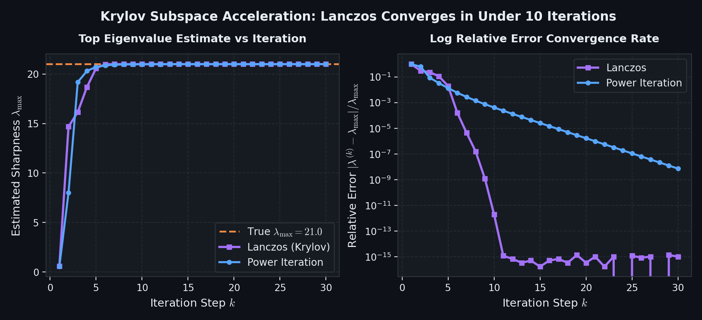
</p>
<p align="center"><em>Top eigenvalue estimation: Lanczos Krylov acceleration reaches the true extremal eigenvalue $\lambda_{\max}$ in under 10 iterations, significantly outperforming Power Iteration.</em><br/>
<em>Illustration on a synthetic problem; real network results are in Results.</em></p>

#### C. Hutchinson's Trace Estimator

The trace $\operatorname{tr}(H) = \sum_{j=1}^P \lambda_j = \sum_{j=1}^P \frac{\partial^2 \mathcal{L}}{\partial \theta_j^2}$ measures total overall curvature. Using Hutchinson's randomized estimator:

$$\mathbb{E}_{z}[z^T H z] = \mathbb{E}_{z}[\operatorname{tr}(z^T H z)] = \mathbb{E}_{z}[\operatorname{tr}(H z z^T)] = \operatorname{tr}\left( H \mathbb{E}_{z}[z z^T] \right)$$

When probe vectors $z \in \mathbb{R}^P$ are drawn i.i.d. from a Rademacher distribution ($z_i \in \{-1, +1\}$ with probability $p=0.5$), $\mathbb{E}[z z^T] = I_P$. Hutchinson (1990) proved that Rademacher vectors minimize estimator variance $\operatorname{Var}(z^T H z) = 2 \left( \|H\|_F^2 - \sum_{i=1}^P H_{ii}^2 \right)$ compared to Gaussian probes.

With $M$ independent Monte Carlo probes:

$$\widehat{\operatorname{tr}}(H) = \frac{1}{M} \sum_{j=1}^M z_j^T (H z_j)$$

Each probe requires exactly one Hessian-vector product $H z_j$.

<p align="center">
  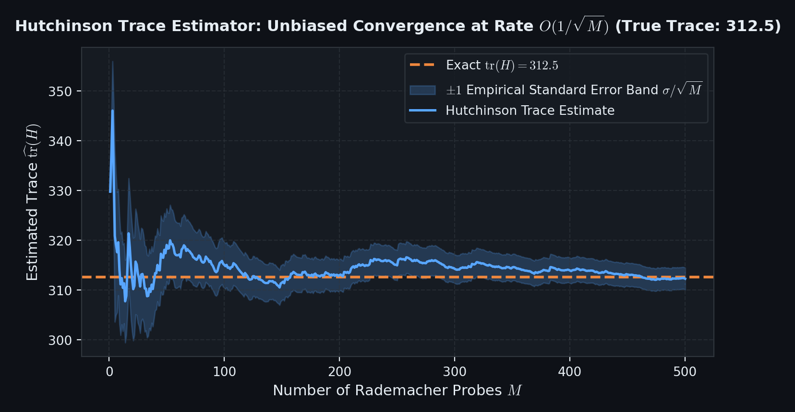
</p>
<p align="center"><em>Hutchinson trace estimation with Rademacher probes: empirical convergence toward true trace with $\pm 1$ standard-error band at rate $O(1/\sqrt{M})$.</em><br/>
<em>Illustration on a synthetic problem; real network results are in Results.</em></p>

#### D. Stochastic Lanczos Quadrature (SLQ) for Spectral Density

The empirical spectral density (ESD) represents the full distribution of Hessian eigenvalues:

$$\rho(\lambda) \equiv \frac{1}{P} \sum_{j=1}^P \delta(\lambda - \lambda_j)$$

For any smooth function $f$:

$$\int_{-\infty}^\infty f(\lambda) \rho(\lambda) d\lambda = \frac{1}{P} \operatorname{tr}(f(H)) \approx \frac{1}{M \cdot P} \sum_{j=1}^M z_j^T f(H) z_j$$

Applying $m$ steps of the Lanczos algorithm to probe vector $z_j / \|z_j\|_2$ yields tridiagonal matrix $T_m^{(j)}$ with eigenvalues $\theta_k^{(j)}$ and eigenvectors $w_k^{(j)}$. By Gaussian quadrature:

$$z_j^T f(H) z_j \approx \|z_j\|_2^2 \sum_{k=1}^m \left( [w_k^{(j)}]_1 \right)^2 f\left(\theta_k^{(j)}\right)$$

Smoothing this discrete sum with a Gaussian kernel density estimator produces the continuous spectral density curve $\rho(\lambda)$, exposing bulk distribution, outlier eigenvalues, and spectral gaps (Ghorbani et al., 2019).

<p align="center">
  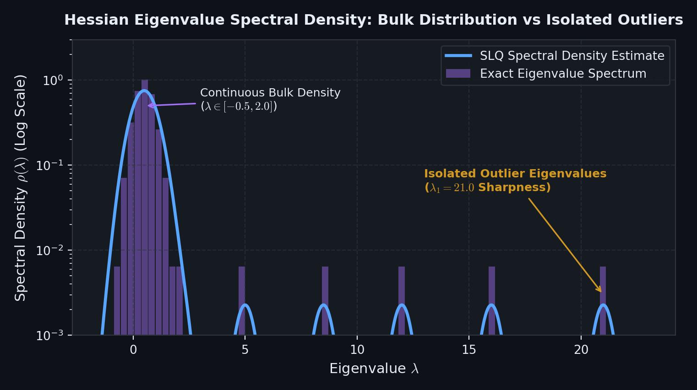
</p>
<p align="center"><em>Eigenvalue spectral density $\rho(\lambda)$ estimated via Stochastic Lanczos Quadrature (SLQ) overlaid on the exact spectrum of a synthetic matrix.</em><br/>
<em>Illustration on a synthetic problem; real network results are in Results.</em></p>

### 7. Filter-Normalized Random Directions (Li et al., 2018)

Visualizing the loss landscape requires evaluating $\mathcal{L}(\theta^* + \alpha \delta_1 + \beta \delta_2)$ over a 2D grid $(\alpha, \beta) \in [-1, 1]^2$.

However, modern networks with Batch Normalization and ReLU activations possess scale invariance: scaling the weights $W_l$ of layer $l$ by factor $\gamma$ and subsequent layer $W_{l+1}$ by $1/\gamma$ leaves network predictions unchanged:

$$f(x; \gamma W_l, \gamma^{-1} W_{l+1}) = f(x; W_l, W_{l+1})$$

Under naive isotropic perturbations $\delta \sim \mathcal{N}(0, I)$, layers with large weight norms appear deceptively flat, whereas layers with small weight norms appear deceptively sharp. To eliminate parameter scale artifacts, Li et al. (2018) introduced **filter-wise normalization**:

Let $\theta_{l,j}$ denote the $j$-th convolutional filter (or linear neuron weight slice) of layer $l$, and $d_{l,j}$ denote the corresponding slice of random direction vector $d$. Each filter direction is normalized to match the Frobenius norm of its corresponding filter:

$$d_{l,j} \leftarrow \frac{d_{l,j}}{\|d_{l,j}\|_F} \|\theta_{l,j}\|_F$$

For bias terms and 1D parameters, vector-level normalization applies: $d_l \leftarrow \frac{d_l}{\|d_l\|_2} \|\theta_l\|_2$. This ensures that perturbation scales are proportional to parameter magnitudes across all network depths.

<p align="center">
  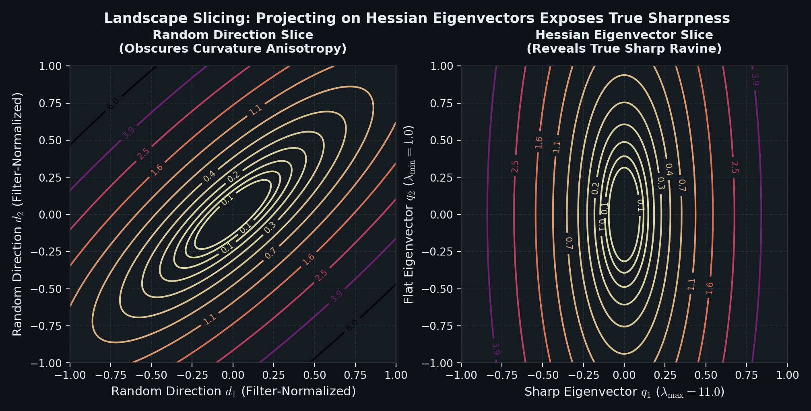
</p>
<p align="center"><em>2D loss landscape slicing: Isotropic random directions (left) obscure directional curvature, whereas slicing along Hessian eigenvectors (right) exposes the true sharp ravine along $q_1$.</em><br/>
<em>Illustration on a synthetic problem; real network results are in Results.</em></p>

---

## Architecture

The following six diagrams specify the modular system architecture of `hesse`, from data ingestion and autograd mechanics to module dependencies and landscape projection.

### A. End-to-End Pipeline Flowchart

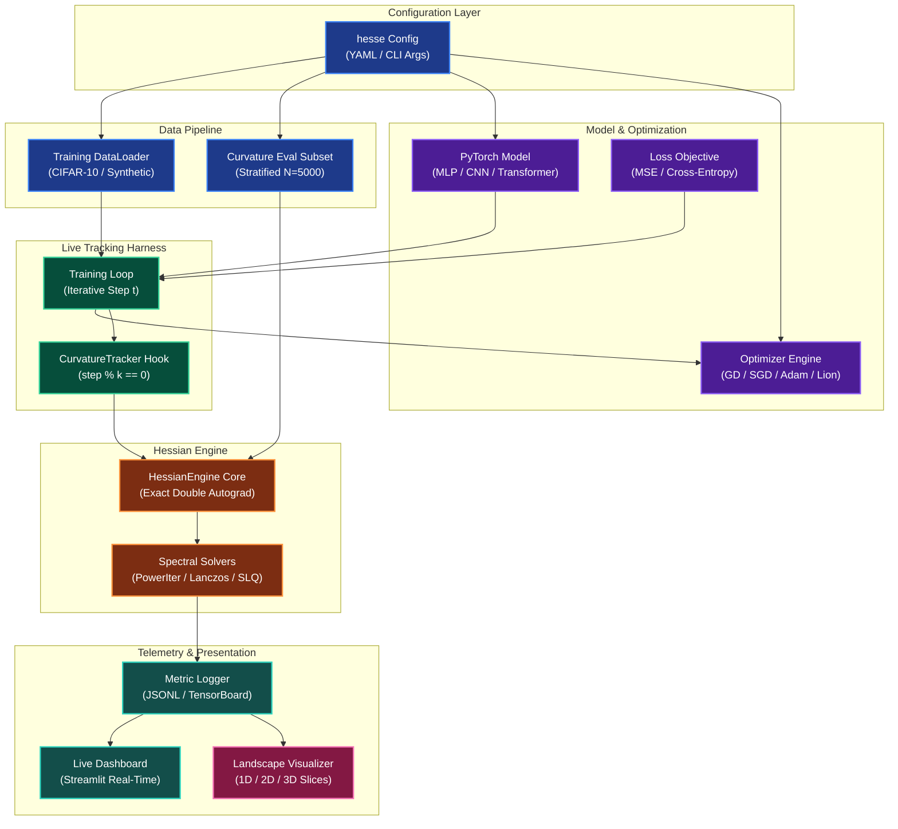

### B. Hessian Engine Flowchart

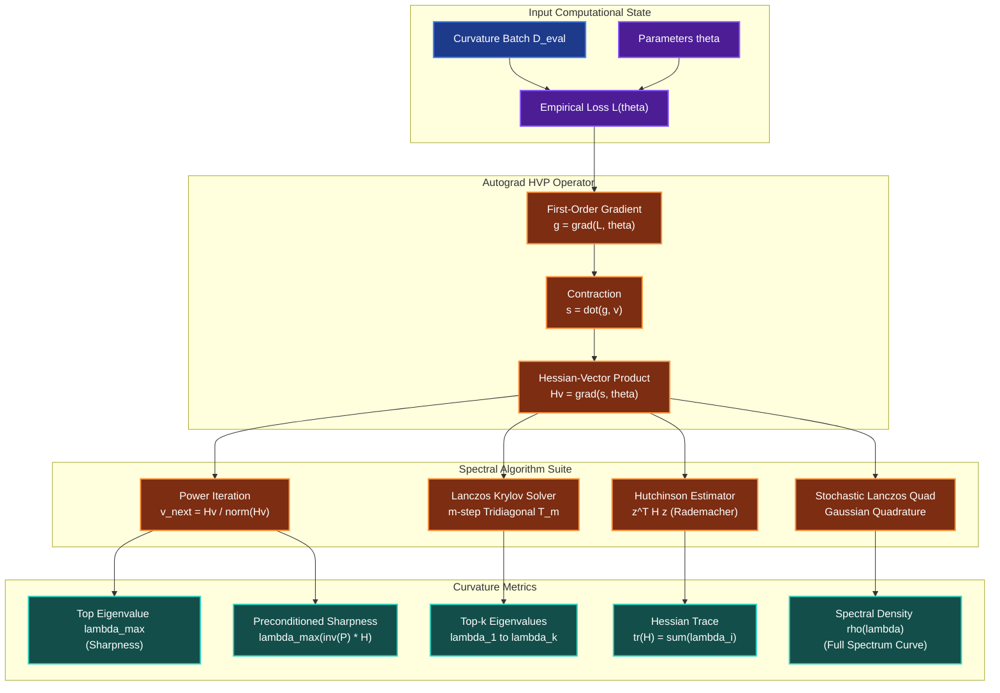

### C. Sequence Diagram: Single Training Step with Tracker Hook

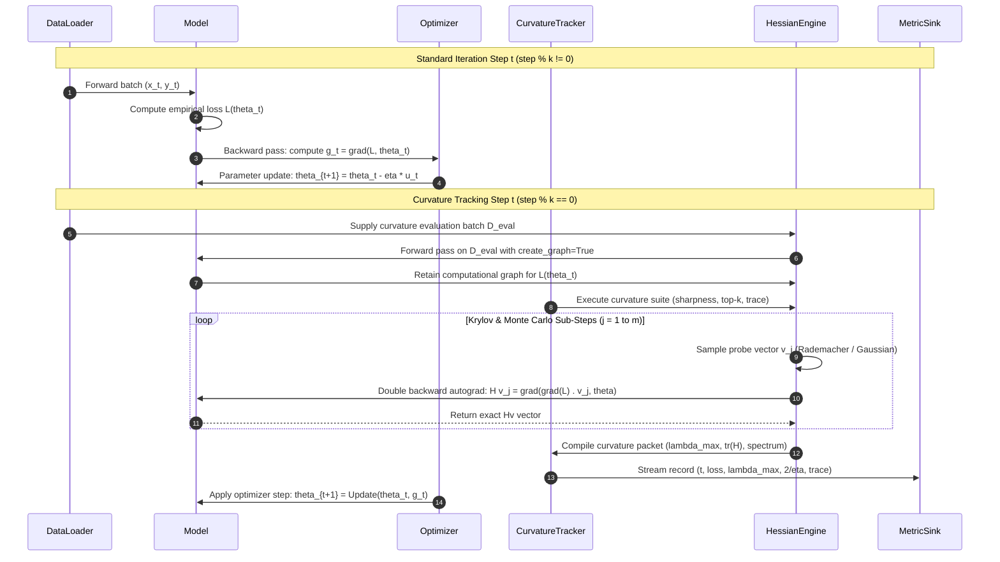

### D. Module Dependency Graph (`src/hesse`)

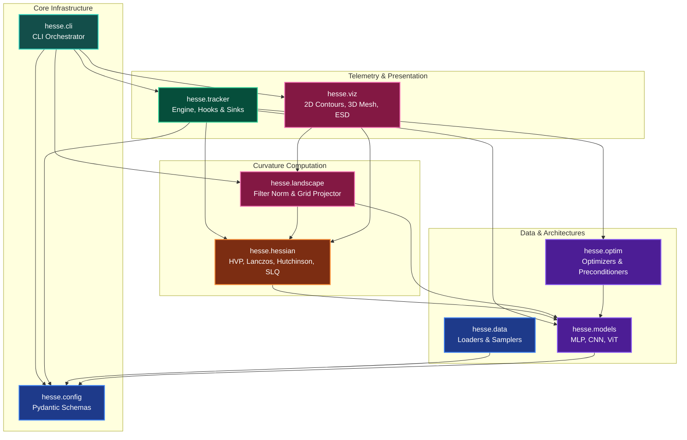

### E. Experiment Decision Tree

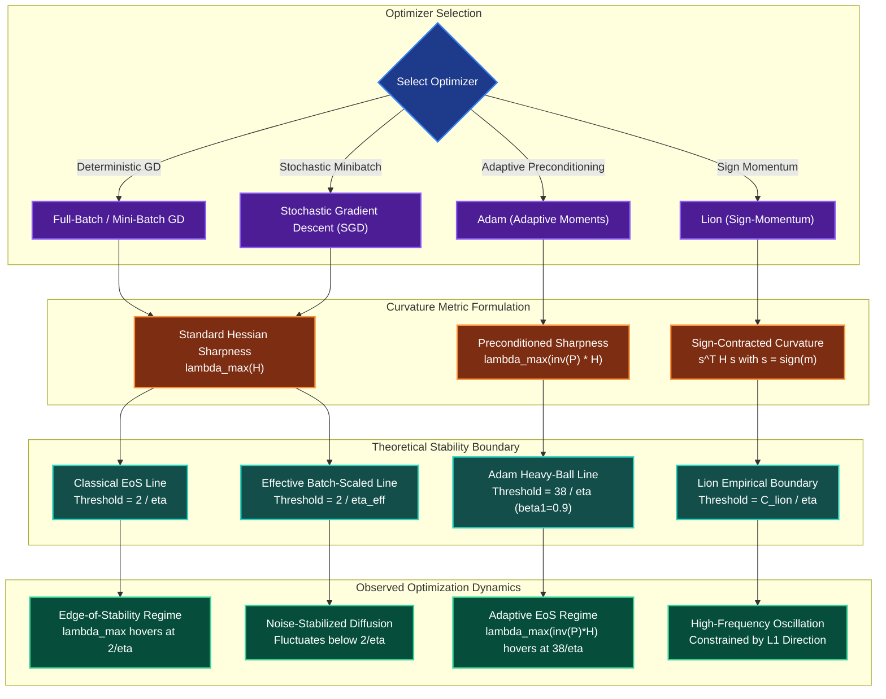

### F. Landscape Generation Flowchart

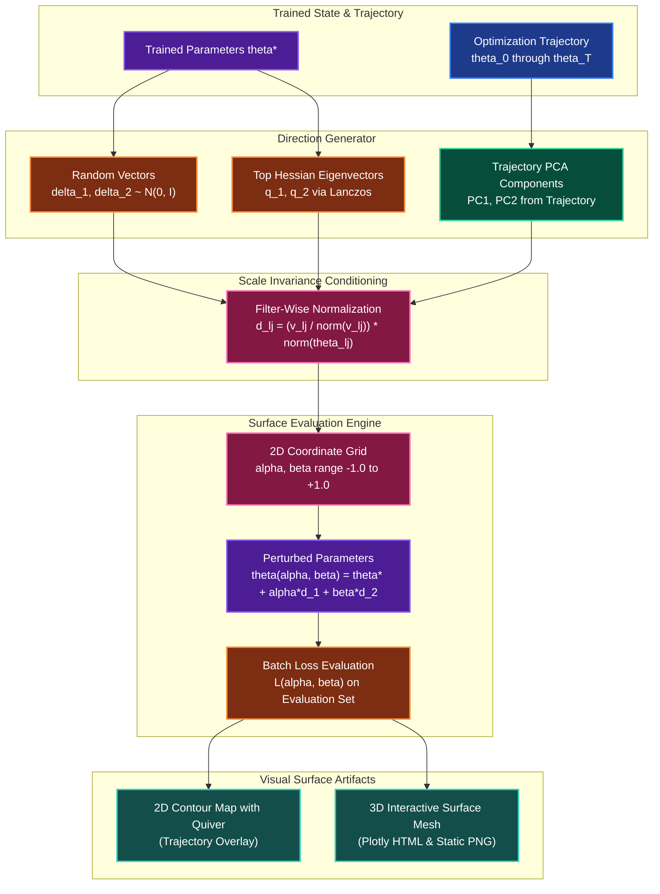

### Tensor Dimensions and Shapes

The following table details the primary tensors manipulated across the computational stages of `hesse`:

| Tensor / Mathematical Object | Symbol | PyTorch Shape | Dtype | Description |
| :--- | :--- | :--- | :--- | :--- |
| Flattened Parameter Vector | $\theta$ | `(P,)` | `torch.float32` | Concatenated vector of all trainable parameters, $P = \sum_l \operatorname{numel}(\theta_l)$. |
| First-Order Gradient Vector | $g = \nabla_\theta \mathcal{L}$ | `(P,)` | `torch.float32` | Instantaneous batch loss gradient with graph retained for HVP. |
| Probe Vector | $v$ or $z$ | `(P,)` | `torch.float32` | Normalized direction (Power Iteration), Rademacher ($\pm 1$), or Gaussian. |
| Hessian-Vector Product | $Hv$ | `(P,)` | `torch.float32` | Exact double backward autograd output vector; identical memory footprint to $\theta$. |
| Lanczos Basis Matrix | $V_m$ | `(P, m)` | `torch.float32` | Orthonormal basis vectors spanning the Krylov subspace $\mathcal{K}_m(H, v_1)$, $m \ll P$. |
| Lanczos Tridiagonal Matrix | $T_m$ | `(m, m)` | `torch.float32` | Symmetric tridiagonal representation $V_m^T H V_m$; contains $\{\alpha_j\}_{j=1}^m$ and $\{\beta_j\}_{j=1}^{m-1}$. |
| Top-$k$ Eigenvalues | $\{\lambda_j\}_{j=1}^k$ | `(k,)` | `torch.float32` | Converged extremal Ritz values of $T_m$, sorted in descending order ($k \le m$). |
| Adam Preconditioner Vector | $P_{\text{diag}}$ | `(P,)` | `torch.float32` | Diagonal entries $\sqrt{\hat{v}_t} + \varepsilon$ extracted from optimizer state buffers. |
| Filter-Normalized Direction | $d_1, d_2$ | `(P,)` | `torch.float32` | Layer-wise and filter-wise scaled vectors matching $\|\theta_{l,j}\|_F$. |
| 2D Meshgrid Coordinates | $\alpha, \beta$ | `(N_g, N_g)` | `torch.float32` | Discretized coordinate grid over $[-1, 1] \times [-1, 1]$ with resolution $N_g \times N_g$. |
| Evaluated Loss Surface | $\mathcal{L}(\alpha, \beta)$ | `(N_g, N_g)` | `torch.float32` | Evaluated scalar loss values across all grid parameter perturbations. |

---

## Planned Experiments

The following controlled empirical campaigns are designed to test the limits of Edge-of-Stability theory across optimizers, architectures, and objectives:

| ID | Research Question | Experimental Setup | Key Curvature Metric | Theoretical Stability Threshold | Expected Phenomenological Outcome |
| :---: | :--- | :--- | :--- | :--- | :--- |
| **E1** | Does full-batch GD enter EoS on standard vision subsets? | CIFAR-10 (5k subset), 3-layer MLP and ResNet-18 (no BatchNorm), MSE loss, full-batch GD with learning rates $\eta \in \{0.01, 0.05, 0.1, 0.2\}$. | $\lambda_{\max}(H)$ via Power Iteration evaluated every 10 steps. | $2/\eta$ | Progressive sharpening drives $\lambda_{\max}$ to $2/\eta$. Trajectory enters EoS, hovering near $2/\eta$; loss oscillates step-to-step but decays monotonically at epoch scale. |
| **E2** | How does minibatch SGD stochasticity modulate EoS? | ResNet-18 on CIFAR-10, constant $\eta = 0.05$, varying batch sizes $B \in \{32, 128, 512, 2048, 5000\}$. | Minibatch $\lambda_{\max}(H_B)$ vs full-dataset $\lambda_{\max}(H_{\text{full}})$, trace $\operatorname{tr}(H)$. | $2/\eta_{\text{eff}}$ with $\eta_{\text{eff}} = \eta \cdot \frac{B}{N}$ | Large batch sizes ($B \ge 2048$) replicate full-batch EoS plateauing at $2/\eta$. Small batch sizes ($B \le 128$) dissipate curvature via stochastic gradient noise, suppressing $\lambda_{\max}$ well below $2/\eta$. |
| **E3** | Does Adam exhibit an adaptive EoS at $38/\eta$? | CIFAR-10, CNN without BatchNorm, Adam ($\beta_1=0.9, \beta_2=0.999$), $\eta \in \{10^{-4}, 10^{-3}, 3 \times 10^{-3}\}$, Cross-Entropy & MSE. | Raw $\lambda_{\max}(H)$ vs preconditioned sharpness $\lambda_{\max}(P_t^{-1} H)$. | $\frac{2 + 2\beta_1}{(1 - \beta_1)\eta} = \frac{38}{\eta}$ | Raw $\lambda_{\max}(H)$ does not stabilize at $2/\eta$. Preconditioned sharpness $\lambda_{\max}(P_t^{-1} H)$ sharpens progressively and hovers around $38/\eta$, confirming Cohen et al. (2022). |
| **E4** | What governs stability in sign-based optimizers (Lion)? | CIFAR-10, ResNet-18, Lion optimizer ($\beta_1=0.9, \beta_2=0.99$), $\eta \in \{10^{-4}, 3 \times 10^{-4}, 10^{-3}\}$. | Directional curvature $\frac{u_t^T H u_t}{\|u_t\|_2^2}$ along sign vector $u_t = \operatorname{sign}(m_t)$ and $\lambda_{\max}(H)$. | Coordinate $L_1$ contraction boundary | Because Lion takes uniform $\pm 1$ step sizes, classical $L_2$ quadratic bounds break down. Trajectory exhibits high-frequency oscillations bounded by coordinate saturation rather than hovering at $2/\eta$. |
| **E5** | Are EoS dynamics universal across MLPs, CNNs, and ViTs? | CIFAR-10 (5k subset), standardized $\approx 500\text{k}$ parameter budget: 3-layer MLP, 4-layer ConvNet, and 4-layer Tiny Vision Transformer (patch size 4), GD ($\eta = 0.05$). | $\lambda_{\max}(H)$, Top-10 spectral gap $\lambda_1 - \lambda_2$, and ESD $\rho(\lambda)$ via SLQ. | $2/\eta = 40.0$ | All architectures exhibit progressive sharpening and EoS hovering. Tiny ViT displays a substantially larger outlier spectral gap ($\lambda_1 \gg \lambda_2$) compared to ConvNet's continuous bulk density. |
| **E6** | Does loss function geometry alter late-stage EoS stability? | ResNet-18 on CIFAR-10, identical initialization, comparing one-hot MSE loss vs categorical Cross-Entropy loss, GD ($\eta = 0.05$). | $\lambda_{\max}(H)$, trace $\operatorname{tr}(H)$, and Gauss-Newton vs residual ratio. | $2/\eta = 40.0$ | MSE loss maintains persistent EoS hovering indefinitely. Cross-Entropy allows unbounded logit growth, causing late-time decay of Hessian scale ("late-time flattening") below $2/\eta$. |

<p align="center">
  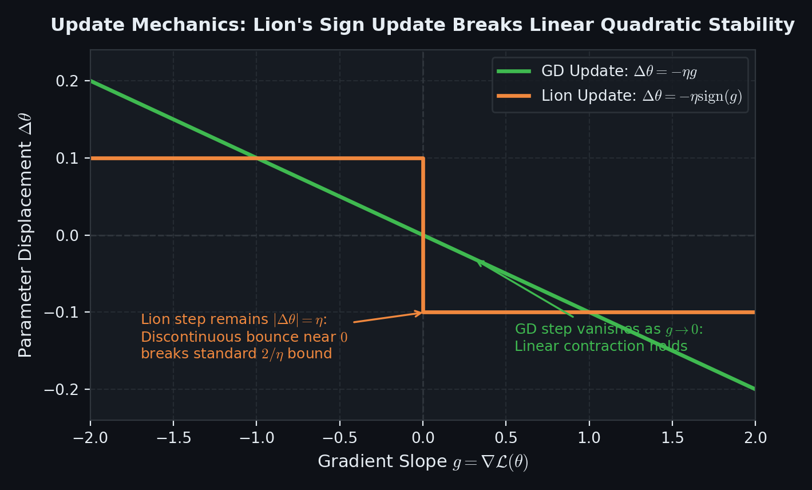
</p>
<p align="center"><em>Update mechanics: Gradient descent step size contracts linearly as $g \to 0$, whereas Lion's discontinuous $\pm \eta$ sign update maintains constant magnitude near minima, breaking linear quadratic $2/\eta$ stability bounds (Experiment E4).</em></p>

---

## Repository Structure

```
hesse/
├── .github/
│   └── workflows/
│       └── ci.yml               # Automated test suite and ruff linter (Phase 8)
├── app/
│   ├── __init__.py
│   └── dashboard.py             # Streamlit real-time curvature telemetry dashboard
├── configs/
│   ├── default.yaml             # Baseline hyperparameters and tracking settings
│   └── experiments/
│       ├── e1_gd_eos.yaml       # E1: Full-batch GD Edge of Stability
│       ├── e2_sgd_batch.yaml    # E2: SGD batch size scaling
│       ├── e3_adam_eos.yaml     # E3: Adam preconditioned sharpness
│       ├── e4_lion.yaml         # E4: Lion sign-momentum dynamics
│       ├── e5_archs.yaml        # E5: Architecture comparison (MLP, CNN, Transformer)
│       └── e6_objectives.yaml   # E6: MSE vs Cross-Entropy geometry
├── docs/
│   └── figures/                 # Rendered figures, loss landscape surfaces & spectra
├── experiments/
│   ├── __init__.py
│   ├── run_e1_gd_eos.py
│   ├── run_e2_sgd_batch.py
│   ├── run_e3_adam_eos.py
│   ├── run_e4_lion.py
│   ├── run_e5_archs.py
│   └── run_e6_objectives.py
├── paper/
│   ├── main.tex                 # Research paper draft summarizing empirical findings
│   └── references.bib           # BibTeX bibliography
├── src/
│   └── hesse/
│       ├── __init__.py
│       ├── cli.py               # Main CLI interface (hesse track, hesse landscape, etc.)
│       ├── config.py            # Pydantic configuration schemas and validation
│       ├── data/
│       │   ├── __init__.py
│       │   ├── cifar.py         # CIFAR-10 downloader and stratified 5k subset generator
│       │   ├── sampler.py       # Deterministic full-batch / mini-batch samplers
│       │   └── synthetic.py     # Quadratic & ill-conditioned synthetic objectives
│       ├── hessian/
│       │   ├── __init__.py
│       │   ├── density.py       # Stochastic Lanczos Quadrature (SLQ) spectral density
│       │   ├── hutchinson.py    # Hutchinson trace estimator with Rademacher distribution
│       │   ├── hvp.py           # Exact Hessian-vector product via double autograd
│       │   ├── lanczos.py       # Lanczos algorithm for top-k eigenvalues and Ritz vectors
│       │   └── power_iter.py    # Fast power iteration for top eigenvalue (sharpness)
│       ├── landscape/
│       │   ├── __init__.py
│       │   ├── directions.py    # Filter-normalized random, top eigenvector, and PCA bases
│       │   ├── grid.py          # 2D coordinate grid projector and loss evaluator
│       │   └── surface.py       # 3D mesh generator and level-set contour exporter
│       ├── models/
│       │   ├── __init__.py
│       │   ├── cnn.py           # Standard ConvNet and non-BatchNorm ResNet architectures
│       │   ├── mlp.py           # Deep Multi-Layer Perceptrons for CIFAR-10 / synthetic
│       │   └── transformer.py   # Miniature Vision Transformer (ViT) implementation
│       ├── optim/
│       │   ├── __init__.py
│       │   ├── factory.py       # Unified optimizer constructor (GD, SGD, Adam, Lion)
│       │   ├── lion.py          # PyTorch native Lion optimizer with sign-momentum
│       │   └── preconditioner.py# Adam diagonal preconditioner extraction and inversion
│       ├── tracker/
│       │   ├── __init__.py
│       │   ├── engine.py        # CurvatureTracker orchestrator hook
│       │   ├── metrics.py       # Telemetry aggregation (lambda_max, trace, loss, lr)
│       │   └── sink.py          # Asynchronous JSONL, CSV, and TensorBoard logging sinks
│       └── viz/
│           ├── __init__.py
│           ├── landscape_3d.py  # Plotly interactive 3D loss surface renderer
│           ├── plots.py         # Matplotlib / Seaborn publication-ready trajectory plots
│           └── spectral.py      # Eigenvalue spectral density (ESD) histogram / KDE plotter
├── tests/
│   ├── conftest.py              # Pytest fixtures and mock quadratic models
│   ├── integration/
│   │   ├── test_e2e_tracking.py
│   │   └── test_landscape_pipeline.py
│   └── unit/
│       ├── test_filter_norm.py
│       ├── test_hutchinson.py
│       ├── test_hvp.py
│       ├── test_lanczos.py
│       └── test_power_iteration.py
├── Makefile                     # Developer targets (test, lint, format, run-all)
├── pyproject.toml               # PEP 621 package metadata and dependency specifications
└── README.md                    # Project specification, mathematical blueprint & guide
```

---

## Quickstart

<!-- The commands below are design specifications and will become fully functional in Phase 2+ -->

### 1. Installation

```bash
# Clone the repository
git clone https://github.com/hesse-org/hesse.git
cd hesse

# Create and activate a Python 3.10+ virtual environment
python3 -m venv .venv
source .venv/bin/activate

# Install hesse in editable mode with development dependencies
pip install -e ".[dev]"
```

### 2. Live Curvature Tracking CLI

Track loss, $\lambda_{\max}$, and theoretical stability thresholds during model training:

```bash
# Execute Experiment 1: Full-batch GD on CIFAR-10 (coming in Phase 2+)
hesse track --config configs/experiments/e1_gd_eos.yaml

# Run with custom parameters directly via CLI flags
hesse track \
  --model cnn \
  --dataset cifar10 \
  --subset-size 5000 \
  --optimizer gd \
  --lr 0.05 \
  --loss mse \
  --track-interval 10 \
  --metrics sharpness,trace,topk \
  --log-dir runs/cifar_gd_e1/
```

### 3. Launching the Real-Time Streamlit Dashboard

Stream curvature trajectories and eigenvalue spectral densities live during training runs:

```bash
# Launch interactive dashboard in browser (coming in Phase 4+)
hesse dashboard --log-dir runs/cifar_gd_e1/ --port 8501
```

### 4. Visualizing 2D and 3D Loss Landscapes

Extract filter-normalized 2D slices and interactive 3D meshes around trained checkpoints:

```bash
# Compute and export filter-normalized landscape surface (coming in Phase 5+)
hesse landscape \
  --checkpoint runs/cifar_gd_e1/checkpoint_final.pt \
  --basis top_hessian \
  --norm filter \
  --grid-size 50 \
  --range 1.0 \
  --output docs/figures/landscape_3d_surface.png
```

---

## Results

*The subsections below define the target research artifacts and figure locations for all planned experiments. Real experimental data will be populated during Phase 6.*

### Experiment 1: Gradient Descent Edge of Stability (CIFAR-10)

Target artifact: `docs/figures/e1_gd_eos_trajectory.png`

Dual-axis trajectory tracking loss $\mathcal{L}(\theta_t)$ on the left logarithmic axis and sharpness $\lambda_{\max}(H_t)$ on the right linear axis, benchmarked against the theoretical stability threshold $2/\eta = 40.0$. Demonstrates progressive sharpening followed by hovering at $2/\eta$.

*Status: Pending: produced in Phase 6.*

---

### Experiment 2: SGD Batch Size and Curvature Noise

Target artifact: `docs/figures/e2_sgd_batch_size_scaling.png`

Comparative trajectory curves illustrating $\lambda_{\max}$ across batch sizes $B \in \{32, 128, 512, 2048, 5000\}$. Highlights the transition from noise-driven dissipation (small batch) to deterministic EoS boundary hovering (large batch).

*Status: Pending: produced in Phase 6.*

---

### Experiment 3: Adam Preconditioned Sharpness vs 38/η

Target artifact: `docs/figures/e3_adam_preconditioned_sharpness.png`

Direct comparison between unconditioned Hessian sharpness $\lambda_{\max}(H)$ and preconditioned sharpness $\lambda_{\max}(P_t^{-1} H)$ under Adam ($\beta_1=0.9, \eta=10^{-3}$). Tests whether preconditioned curvature tracks the analytical $38/\eta$ stability line.

*Status: Pending: produced in Phase 6.*

---

### Experiment 4: Lion Sign-Update Geometry

Target artifact: `docs/figures/e4_lion_sign_dynamics.png`

Analysis of directional curvature along sign update vectors $u_t = \operatorname{sign}(m_t)$ vs unconstrained Hessian spectrum. Demonstrates how coordinate-wise saturation regulates optimization dynamics without requiring $L_2$ eigenvalue boundedness.

*Status: Pending: produced in Phase 6.*

---

### Experiment 5: Architectural Curvature Comparison (MLP vs CNN vs ViT)

Target artifact: `docs/figures/e5_architecture_curvature_comparison.png`

Overlay of top-10 eigenvalue spectra $\{\lambda_1, \dots, \lambda_{10}\}$ and empirical spectral density $\rho(\lambda)$ across standardized parameter-matched MLP, ConvNet, and Tiny Vision Transformer architectures. Evaluates differences in spectral gap and bulk density.

*Status: Pending: produced in Phase 6.*

---

### Experiment 6: Objective Geometry: MSE vs Cross-Entropy

Target artifact: `docs/figures/e6_loss_function_spectral_density.png`

Long-horizon curvature comparison under gradient descent between Mean Squared Error and Cross-Entropy. Highlights persistent EoS hovering under MSE versus late-stage flattening caused by logit norm divergence under Cross-Entropy.

*Status: Pending: produced in Phase 6.*

---

### Loss Landscape Topography

Target artifact: `docs/figures/landscape_3d_surface.png`

High-resolution 3D loss landscape surface and 2D contour map evaluated along filter-normalized top Hessian eigenvectors $q_1, q_2$, with the optimization trajectory $\{\theta_0, \dots, \theta_T\}$ projected onto the surface.

*Status: Pending: produced in Phase 6.*

---

## Roadmap

The implementation of `hesse` proceeds through nine sequential phases:

- [x] **Phase 1: Project Blueprint & Mathematical Architecture**
  - [x] Author comprehensive `README.md` design specification and mathematical blueprint.
  - [x] Formulate exact LaTeX derivations for linear stability thresholds ($2/\eta$ and $38/\eta$).
  - [x] Specify system diagrams and data flow structures.
- [ ] **Phase 2: Core Hessian Engine & Spectral Solvers**
  - [ ] Implement exact Hessian-vector products (`src/hesse/hessian/hvp.py`).
  - [ ] Implement Power Iteration solver for $\lambda_{\max}$ (`power_iter.py`).
  - [ ] Implement Lanczos algorithm for top-$k$ eigenvalues and Ritz vectors (`lanczos.py`).
  - [ ] Implement Hutchinson's trace estimator with Rademacher probes (`hutchinson.py`).
  - [ ] Implement Stochastic Lanczos Quadrature (SLQ) for spectral density $\rho(\lambda)$ (`density.py`).
- [ ] **Phase 3: Telemetry Engine, Tracking Hooks & Pipeline Integration**
  - [ ] Build `CurvatureTracker` training harness hook (`src/hesse/tracker/engine.py`).
  - [ ] Implement streaming telemetry sinks for JSONL, CSV, and TensorBoard (`sink.py`).
  - [ ] Implement dataset loaders and stratified 5k CIFAR-10 samplers (`src/hesse/data/`).
  - [ ] Implement MLP, ConvNet, and Tiny ViT architectures (`src/hesse/models/`).
  - [ ] Implement optimizer factory with GD, SGD, Adam, and Lion (`src/hesse/optim/`).
- [ ] **Phase 4: Live Telemetry Dashboard & Real-Time Visualization**
  - [ ] Construct interactive Streamlit application (`app/dashboard.py`).
  - [ ] Render real-time multi-metric trajectory plots with dynamic $2/\eta$ threshold lines.
  - [ ] Build live ESD spectral density histogram visualizer (`src/hesse/viz/spectral.py`).
- [ ] **Phase 5: Filter-Normalized Loss Landscape Slicing Engine**
  - [ ] Implement filter-wise weight normalization for Conv2d and Linear layers (`landscape/directions.py`).
  - [ ] Implement top Hessian eigenvector and trajectory PCA projection bases.
  - [ ] Construct 2D grid evaluator and 3D surface generator (`landscape/grid.py`, `landscape/surface.py`).
  - [ ] Implement interactive Plotly and publication-quality Matplotlib exporters (`viz/landscape_3d.py`).
- [ ] **Phase 6: Empirical Research Campaigns (Experiments E1–E6)**
  - [ ] Run Experiment E1: Full-batch GD Edge of Stability on CIFAR-10 5k subset.
  - [ ] Run Experiment E2: SGD batch size scaling and stochastic curvature dissipation.
  - [ ] Run Experiment E3: Adam preconditioned sharpness vs $38/\eta$.
  - [ ] Run Experiment E4: Lion optimizer sign-update dynamics.
  - [ ] Run Experiment E5: Architectural comparison (MLP vs CNN vs ViT).
  - [ ] Run Experiment E6: Loss function geometry (MSE vs Cross-Entropy).
  - [ ] Export all publication figures into `docs/figures/`.
- [ ] **Phase 7: Test Suite & Mathematical Invariant Verification**
  - [ ] Author unit tests verifying exact analytical HVP on synthetic quadratic forms.
  - [ ] Validate Power Iteration and Lanczos against dense `torch.linalg.eigh` baselines.
  - [ ] Validate Hutchinson trace estimator against exact matrix traces on small networks.
  - [ ] Validate filter normalization scale invariance under arbitrary parameter re-scaling.
- [ ] **Phase 8: CI/CD Pipeline, Ruff Code Quality & Packaging**
  - [ ] Configure `pyproject.toml` with PEP 621 metadata, dependencies, and optional extras.
  - [ ] Set up GitHub Actions workflow (`.github/workflows/ci.yml`) for multi-OS tests.
  - [ ] Enforce automated linting and formatting via Ruff.
  - [ ] Replace build badge placeholder with active CI status badge.
- [ ] **Phase 9: Empirical Research Paper Draft & Open-Source Release**
  - [ ] Compile empirical findings into LaTeX research paper template (`paper/main.tex`).
  - [ ] Document reproducibility benchmarks and command-line recipes.
  - [ ] Finalize documentation and release `hesse` v0.1.0 on PyPI.

---

## Limitations and Future Work

While `hesse` provides fine-grained visibility into optimization geometry, several theoretical and computational challenges remain:

1. **Computational Overhead of Double Backpropagation:** Each Hessian-vector product requires an autograd graph retention pass and a second backward pass, roughly doubling the backward runtime per probe vector. Running $m = 20$ Lanczos steps or $M = 30$ Hutchinson probes at every training step would be prohibitively slow. `hesse` addresses this via periodic evaluation (e.g., every $k = 10$ or $k = 50$ steps) on fixed stratified evaluation subsets, but zero-overhead continuous monitoring remains an open engineering frontier.
2. **Batch Subsampling Noise:** Computing curvature over a mini-batch yields a stochastic approximation $H_B(\theta)$ of the true population Hessian $H_{\mathcal{D}}(\theta)$. As batch size shrinks, variance in the top eigenvector subspace increases, potentially masking fine-grained Edge-of-Stability dynamics.
3. **Beyond Second-Order Quadratic Approximations:** The $2/\eta$ stability line is derived from local quadratic approximations. When networks operate deep within the Edge of Stability, higher-order derivatives (such as cubic tensor forms $\nabla^3 \mathcal{L}(\theta)[v, v, v]$) dictate self-stabilization. Extending `hesse` to higher-order directional derivatives represents an active research vector.
4. **Non-Diagonal Adaptive Curvature:** The analytical stability bound $38/\eta$ holds for diagonal preconditioners like Adam under isotropic assumptions. More sophisticated optimizers featuring full-matrix or Kronecker-factored preconditioning (e.g., K-FAC, Shampoo) introduce non-diagonal coordinate rotations that require generalized matrix pencil solvers.
5. **Distributed and Foundation Model Scaling:** Tracking curvature on multi-billion parameter models partitioned across multiple GPUs via Distributed Data Parallel (DDP) or Fully Sharded Data Parallel (FSDP) introduces substantial inter-node communication overhead during HVP synchronization. Future versions of `hesse` will investigate sharded HVP routines and low-rank Krylov approximations for large transformer models.

---

## References

1. Cohen, J. M., Kaur, S., Li, Y., Kolter, J. Z., & Talwalkar, A. (2021). Gradient Descent on Neural Networks Typically Occurs at the Edge of Stability. In *International Conference on Learning Representations (ICLR)*.
2. Cohen, J. M., Ghorbani, B., Krishnan, S., Agarwal, N., Medapati, S., Badura, M., Suo, D., Cardoze, D., Dobriban, E., Pennington, J., & Sohl-Dickstein, J. (2022). Adaptive Gradient Methods at the Edge of Stability. *arXiv preprint arXiv:2207.14484*.
3. Yao, Z., Gholami, A., Keutzer, K., & Mahoney, M. W. (2020). PyHessian: Neural Networks Through the Lens of the Hessian. In *2020 IEEE International Conference on Big Data (Big Data)* (pp. 581-590). IEEE.
4. Li, H., Xu, Z., Taylor, G., Studer, C., & Goldstein, T. (2018). Visualizing the Loss Landscape of Neural Nets. In *Advances in Neural Information Processing Systems (NeurIPS 2018)* (Vol. 31).
5. Ghorbani, B., Krishnan, S., & Xiao, Y. (2019). An Investigation into Neural Net Optimization via Hessian Eigenvalue Density. In *International Conference on Machine Learning (ICML 2019)* (pp. 2232-2241). PMLR.
6. Pearlmutter, B. A. (1994). Fast Exact Multiplication by the Hessian. *Neural Computation*, 6(1), 147–160.
7. Chen, X., Liang, C., Huang, D., Real, E., Wang, K., Liu, H., Pham, H., Dong, X., Luong, T., Hsieh, C.-J., Lu, Y., & Le, Q. V. (2023). Symbolic Discovery of Optimization Algorithms. In *Advances in Neural Information Processing Systems (NeurIPS 2023)* (Vol. 36).
8. Damian, A., Nichani, E., & Lee, J. D. (2023). Self-Stabilization: The Implicit Bias of Gradient Descent at the Edge of Stability. In *International Conference on Learning Representations (ICLR 2023)*.
